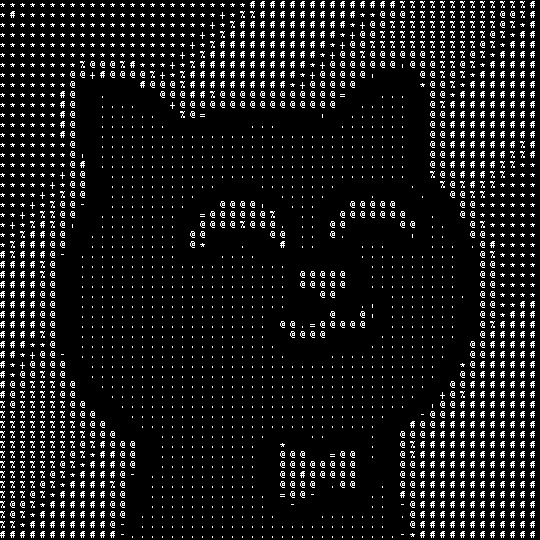

# ascii-media

Turn images and videos into ASCII art from the command line.

ascii-media is one standalone binary for Linux, macOS and Windows. It bundles
ffmpeg, so you do not need to install Python or ffmpeg.

| Input | Output |
| --- | --- |
|  |  |

[Watch the video demo](https://github.com/Doctorthe113/ascii-media-convertor/assets/51150805/4c7d013d-7f5f-4a38-ba23-6a30781d0335)

## Features

- Converts PNG, JPEG, BMP, WebP and TIFF images to an ASCII picture or a text file.
- Converts any video that ffmpeg can read to an ASCII video.
- Keeps the aspect ratio. You set the number of character rows.
- Shows a frame progress bar and an ETA for videos.
- Encodes with any ffmpeg encoder, including GPU encoders such as `h264_nvenc`.
- Updates itself with `ascii-media update`.

## Install

### Linux and macOS

```sh
curl -fsSL https://raw.githubusercontent.com/anargia-pixels/ascii-media-convertor/master/install.sh | sh
```

The script installs the binary to `~/.local/bin/ascii-media`.

### Windows (PowerShell)

```powershell
irm https://raw.githubusercontent.com/anargia-pixels/ascii-media-convertor/master/install.ps1 | iex
```

The script installs the binary to `%LOCALAPPDATA%\Programs\ascii-media` and
adds that directory to your user `PATH`.

### Install options

Both scripts verify the download against the release `SHA256SUMS` file. Set
these environment variables to change the defaults:

| Variable | Default | Effect |
| --- | --- | --- |
| `ASCII_MEDIA_VERSION` | `latest` | Installs a specific release tag, for example `v1.0.0`. |
| `ASCII_MEDIA_INSTALL_DIR` | see above | Installs to a different directory. |

```sh
curl -fsSL https://raw.githubusercontent.com/anargia-pixels/ascii-media-convertor/master/install.sh | ASCII_MEDIA_VERSION=v1.0.0 sh
```

You can also download a binary directly from the
[releases page](https://github.com/anargia-pixels/ascii-media-convertor/releases).

## Usage

```sh
ascii-media INPUT [OPTIONS]
```

| Option | Default | Description |
| --- | --- | --- |
| `-o`, `--output FILE` | `INPUT-ascii.EXT` | Output file. Videos default to `.mp4`, text to `.txt`. |
| `-r`, `--rows N` | `108` | Character rows. Output height is `N x 10` pixels, so 108 gives 1080p. |
| `-t`, `--text` | off | Writes plain text instead of a picture. Images only. |
| `-c`, `--codec NAME` | `libx264` | ffmpeg video encoder. |
| `--crf N` | `23` | Video quality, 0 to 51. A lower value gives better quality and a larger file. |
| `-V`, `--version` | | Shows the version. |
| `-h`, `--help` | | Shows the help. |

### Examples

```sh
ascii-media cat.png                       # writes cat-ascii.png
ascii-media cat.png --text                # writes cat-ascii.txt
ascii-media clip.mp4 -r 72 -o small.mp4   # writes a 720p video
ascii-media clip.mp4 -c h264_nvenc        # encodes on an NVIDIA GPU
ascii-media clip.mp4 -c hevc_amf          # encodes on an AMD GPU
```

The output video has no audio track.

### Update

```sh
ascii-media update
```

The command downloads the latest release for your platform, checks it against
the release `SHA256SUMS` file, and replaces the installed binary. It works only
for the standalone binary. Version 1.0.0 does not have this command, so run the
install script again once to get it.

## How it works

1. Convert the input to grayscale and resize it to `rows` x `columns` pixels.
2. Sharpen the small image so that edges stay visible.
3. Map each pixel brightness to one of ten characters: ` .:-=+*#%@`.
4. Draw each character into a 10 x 10 pixel cell with the Inconsolata font.

For videos, the bundled ffmpeg decodes the frames and encodes the result.

## Development

You need [uv](https://docs.astral.sh/uv/).

```sh
uv sync                                     # create .venv with all dependencies
uv run ascii-media --help                   # run from source
uv run ruff check && uv run ruff format     # lint and format
uv run pyinstaller ascii-media.spec         # build dist/ascii-media
```

### Release

1. Set the new version in `pyproject.toml` and run `uv lock`.
2. Commit, then push a tag such as `v1.1.0`.

The [Build workflow](.github/workflows/build.yml) builds the binaries for
Linux (x86_64, arm64), macOS (x86_64, arm64) and Windows (x86_64). On a `v*`
tag, it publishes them with a `SHA256SUMS` file as a GitHub release.

## License

ascii-media is licensed under the [GNU Affero General Public License v3.0](LICENSE).

The binaries also include third-party software:

- [Inconsolata](https://github.com/googlefonts/Inconsolata), under the
  [SIL Open Font License 1.1](src/ascii_media/assets/OFL.txt).
- [ffmpeg](https://ffmpeg.org) from [imageio-ffmpeg](https://github.com/imageio/imageio-ffmpeg),
  under the GPL.
